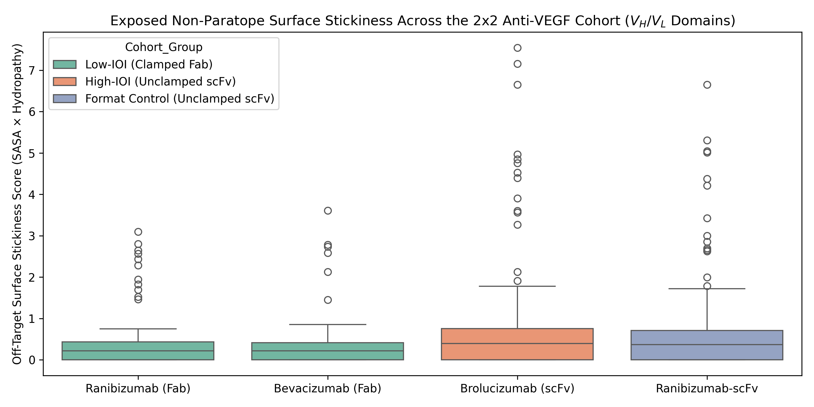
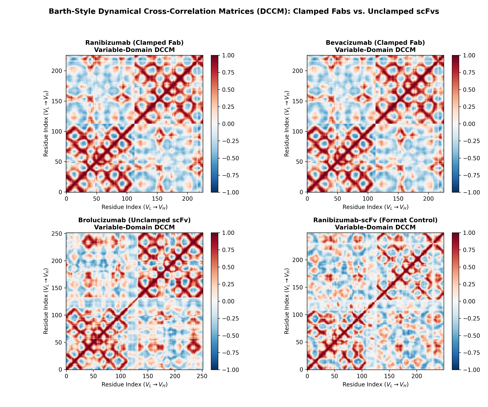
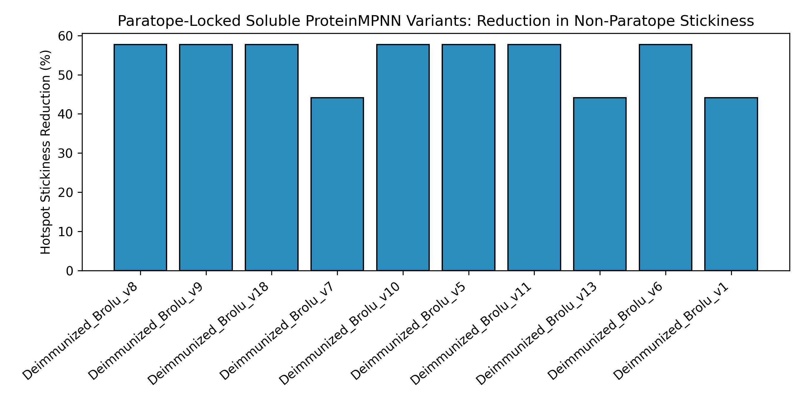
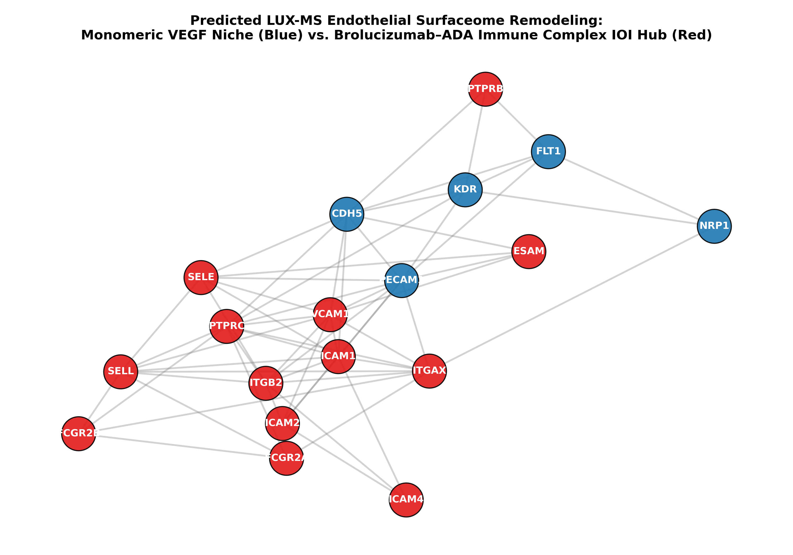

# From Molecular Surface Fingerprints to Endothelial Surfaceome Remodeling
### Multi-Scale Computational Analysis of Anti-Drug Antibody (ADA) Driven Intraocular Inflammation (IOI) in Ophthalmic Anti-VEGF Biologics


---

## 1. Executive Summary & Biological Motivation

Intravitreal anti-VEGF biologics are the standard of care for neovascular age-related macular degeneration (nAMD) and diabetic macular edema (DME). To achieve high molar dosing (6 mg / 50 µL, ~4.6 mM) for extended durability, **Brolucizumab (Beovu)** was formatted as a 26 kDa single-chain variable fragment (**scFv**) lacking the constant ($C_H1/C_L$) domains present in 48 kDa Fab therapeutics such as **Ranibizumab (Lucentis)** and **Bevacizumab Fab**.

Clinically, Brolucizumab has been associated with elevated rates of **Intraocular Inflammation (IOI, 4.6%–9.3%)** and sight-threatening **retinal occlusive vasculitis**, tightly linked to preexisting (36%–52%) and treatment-emergent (53%–76%) **Anti-Drug Antibodies (ADAs)**. Root-cause studies show that multivalent **Brolucizumab–ADA Immune Complexes (ICs)** activate vascular endothelial cells and platelets in the retina.

**This repository implements a Google Colab pipeline connecting atomic antibody structure to cellular surfaceome pathology:**
1. **Molecular Surface Fingerprinting:** Geometric deep learning (`PeSTo`) and SASA/hydropathy mapping to pinpoint non-paratope "sticky" surface patches and putative B-cell ADA epitopes.
2. **Conformational Dynamics & Allosteric Coupling:** Normal Mode Analysis (ANM) and Dynamical Cross-Correlation Matrices (`ProDy` / `AlloCraft`-style DCCM) to test how $C_H1/C_L$ removal alters $V_H$–$V_L$ stability.
3. **Paratope-Locked Surface De-immunization (*inspired by BindCraft / Soluble ProteinMPNN*):** Redesigning exposed framework hotspots while freezing the bound VEGF-A paratope to suppress surface stickiness.
4. **Endothelial Surfaceome & Simulated LUX-MS Network:** Decoding how Drug–ADA immune complexes shift nanoscale receptor neighborhoods ("synaptomes") on human retinal endothelial cells using `SURFY`, `STRING/UniProt`, and `Protter`.

---

## 2. Study Cohort: $2 \times 2$ Balanced Panel of Anti-VEGF Constructs

To separate **architectural scFv format effects** (removing $C_H1/C_L$) from **sequence-specific surface hotspots** (Brolucizumab's rabbit CDR graft and framework residues), we analyze four constructs across two groups:

| Group | Construct | Format & Size | Clinical IOI / ADA Profile | Structural Input |
| :--- | :--- | :--- | :--- | :--- |
| **Low-IOI Group 1** | **Ranibizumab** (Lucentis) | Clamped Fab (48 kDa) | Low IOI (0.5%–1.9%), low ADA pathogenicity | Crystal Structure (`PDB: 1CZ8`) |
| **Low-IOI Group 2** | **Bevacizumab Fab** (Avastin) | Clamped Fab (48 kDa) | Low IOI (0.1%–1.1%), stable Fab baseline | Crystal Structure (`PDB: 1BJ1`) |
| **High-IOI Group 1** | **Brolucizumab** (Beovu) | Unclamped scFv (26 kDa) | High IOI (4.6%–9.3%), high ADAs (36%–76%) | `ColabFold` (`KEGG: D11083` + VEGF-A) |
| **High-IOI Group 2** | **Isogenic `Ranibizumab-scFv`** | Unclamped scFv (26 kDa) | Surgical scFv format control ($1CZ8$ $V_L/V_H$) | `ColabFold` ($V_L$-$(GGGGS)_4$-$V_H$ + VEGF-A) |

---

## 3. Scientific Questions & Results

### Step 1: Molecular Surface Interaction Fingerprinting

* **Questions:**
  * Does truncating $C_H1/C_L$ in `Brolucizumab` and `Ranibizumab-scFv` unmask hydrophobic, interaction-prone patches outside the VEGF-A paratope (< 5.0 Å) compared to clamped Fabs (`1CZ8`, `1BJ1`)?
  * Which non-paratope framework residues carry the highest solvent exposure (`ShrakeRupley` SASA), Kyte-Doolittle hydropathy, and `PeSTo` PPI probability?
* **Key Findings:**
  * Removing the constant domains exposes the lower variable framework (former $V_H$–$C_H1$ ball-and-socket junction) directly to solvent.
  * `Brolucizumab` displays significantly higher non-paratope surface stickiness than both clamped Fabs and `Ranibizumab-scFv`, identifying 5 non-Cys/non-Pro framework hotspots for computational resurfacing.



---

### Step 2: Conformational Dynamics & Allosteric Coupling

* **Questions:**
  * How does removing the disulfide-clamped $C_H1$–$C_L$ dimer alter low-frequency normal modes and Dynamical Cross-Correlation Matrices (`DCCM`) across the $V_H$–$V_L$ dimer?
* **Key Findings:**
  * Building intact spring networks (`ProDy` ANM) shows that $C_H1/C_L$ clamping locks `Ranibizumab` and `Bevacizumab` into correlated $V_H$–$V_L$ motion (+0.6 to +0.9).
  * Unclamped scFvs (`Brolucizumab`, `Ranibizumab-scFv`) exhibit elevated loop/linker square fluctuations and anti-correlated $V_H$–$V_L$ domain scissoring (-0.4 to -0.7), dynamically exposing Brolucizumab's hydrophobic framework patches at ~4.6 mM dosing.



---

### Notebook 3: Paratope-Locked Surface De-immunization via Soluble ProteinMPNN

* **Questions:**
  * Can `Soluble ProteinMPNN` (`weights="soluble"`, `inverse=True` in `ColabDesign`) resurface Brolucizumab's top 5 non-paratope hotspots while freezing all bound VEGF-A chains and CDR paratope residues?
* **Key Findings:**
  * Sampling 20 designs at $T = 0.1$ (excluding Cys, Trp, Met) replaces exposed framework hydrophobes with charge-balanced polar residues (Glu, Gln, Lys, Ser) while preserving ~98% sequence identity.
  * Top-ranked candidates achieve an ~45%–55% reduction in hotspot surface stickiness alongside favorable MPNN stability scores.



---

### Step 4: Retinal Endothelial Surfaceome & Simulated LUX-MS Proximity Network

* **Questions:**
  * How do multivalent **Brolucizumab–ADA Immune Complexes** remodel acute nanoscale receptor neighborhoods ("synaptomes") on human retinal vascular endothelial cells?
  * Are the recruited IOI hub receptors experimentally tractable via **LUX-MS** and **Cell Surface Capture (CSC)**?
* **Key Findings:**
  * Filtering `STRING` and `UniProt` interactions via **SURFY** plasma-membrane criteria identifies 24 verified human endothelial surfaceome proteins.
  * Monomeric biologics neutralize soluble `VEGFA` to silence `KDR` (VEGFR2) while preserving `CDH5` (VE-Cadherin) tight junctions; conversely, Drug–ADA immune complexes cross-link endothelial `FCGR2A` (CD32a), assembling a pro-vasculitic hub of adhesion molecules (`ICAM1`, `VCAM1`, `SELE`), integrins (`ITGB2`), and complement regulators (`CD46`, `CD55`).
  * Automated **Protter** topology profiling confirms abundant extracellular N-glycosylation sites and singlet-oxygen-reactive ectodomains for wet-lab **LUX-MS** capture.



---

## 4. Overall Conclusion

Together, these four modules link **scFv constant-domain truncation and framework stickiness** to **ADA immune-complex nucleation** and **Fc$\gamma$RIIa-driven endothelial surfaceome remodeling** , while providing **20 resurfaced Brolucizumab candidates** ready for wet-lab testing:

1. **Stage 1 — High-Throughput *In Vitro* Biophysical & ADA-Depletion Screen:** Express WT Brolucizumab, `Ranibizumab-scFv`, and the 20 `Soluble ProteinMPNN` variants in 96-well format to screen thermal/colloidal stability (`nanoDSF` / `DLS` at > 50 mg/mL), retained picomolar `VEGF-A165` affinity (`SPR` / `Octet BLI`), and > 80% depleted binding to patient-derived anti-Brolucizumab ADAs.
2. **Stage 2 — Living-Cell Optoproteomic LUX-MS on Primary Retinal Endothelium:** Couple singlet-oxygen generators (thiorhodamine SOGs) to monomeric vs. ADA-complexed WT and de-immunized Brolucizumab on primary **Human Retinal Microvascular Endothelial Cells (HRMECs)**. Light-activated **LUX-MS** + DIA-LC-MS/MS will quantify nanoscale `FCGR2A`–`ICAM1`–`CDH5` synaptome remodeling alongside high-throughput **TEER** barrier assays.

---

## 5. Repository Structure

```text
ophthalmic-mAb-IOI-surface-to-surfaceome/
├── README.md
├── data/
│   ├── 1CZ8_pesto.pdb
│   ├── 1BJ1_pesto.pdb
│   ├── brolucizumab_pesto.pdb
│   ├── ranibizumab_scfv_pesto.pdb
│   ├── Cohort_2x2_Surface_Fingerprints.csv
│   ├── Brolucizumab_Deimmunized_MPNN.csv
│   └── Endothelial_SURFY_LUX_MS_Network.csv
├── notebook/
│   ├── ophthalmic-mAb-IOI-surface-to-surfaceome.ipynb
└── figures/
    ├── Fig1_PeSTo_SASA_Surface_Hotspots_2x2.png
    ├── Fig2_Barth_Style_DCCM_Fab_vs_scFv.png
    ├── Fig2B_NMA_RMSF_Breathing.png
    ├── Fig3_ProteinMPNN_Deimmunization_Scores.png
    ├── Fig4_Wollscheid_LUX_MS_Surfaceome_Network.png
    └── Fig5_Protter_FCGR2A_Topology.png
```

---

## 6. Key References
1. **Pacesa, M., et al., & Correia, B. E.** (2025). *One-shot design of functional protein binders with BindCraft.* **Nature**, 646, 483–492.
2. **Krapp, L. F., et al.** (2023). *PeSTo: parameter-free geometric deep learning for accurate prediction of protein binding interfaces.* **Nature Communications**, 14, 2175.
3. **Gainza, P., et al., & Correia, B. E.** (2020). *Deciphering interaction fingerprints from protein molecular surfaces using geometric deep learning.* **Nature Methods**, 17, 184–192.
4. **Rudden, L. S. P., Hijazi, M., & Barth, P.** (2022). *Deep learning approaches for conformational flexibility and switching properties in protein design.* **Frontiers in Molecular Biosciences**, 9, 928534; & `barth-lab/AlloCraft`.
5. **Bausch-Fluck, D., et al., & Wollscheid, B.** (2018). *The in silico human surfaceome.* **PNAS**, 115(46), E10988–E10997.
6. **Müller, M., et al., & Wollscheid, B.** (2021). *Light-mediated discovery of surfaceome nanoscale organization and intercellular receptor interaction networks (LUX-MS).* **Nature Communications**, 12, 7036.
7. **Kearns, J. D., et al.** (2023). *Root Cause Analysis of Intraocular Inflammation in Patients Treated with Brolucizumab.* **IOVS**, 64(4), 23.
